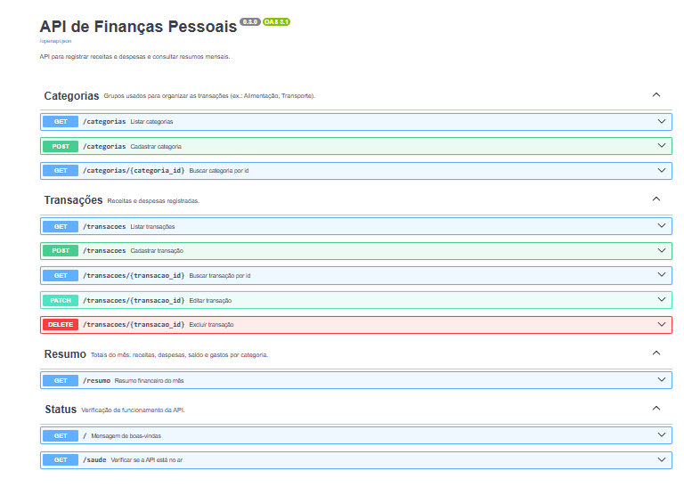

# API de Finanças Pessoais

[](https://github.com/Thailane-SS/api-financas-pessoais/actions/workflows/testes.yml)


API REST para registrar **receitas e despesas**, organizá-las por **categoria** e consultar um **resumo financeiro mensal** (total de receitas, total de despesas, saldo e gastos por categoria).

Projeto de portfólio desenvolvido para praticar a construção de APIs com Python: modelagem de dados, validação de entrada, consultas SQL com agregação, testes automatizados e integração contínua.

> Todos os dados usados nos exemplos e nos testes são **fictícios**.



---

## Funcionalidades

- **Categorias:** cadastrar, listar (em ordem alfabética) e buscar por id. Nomes repetidos são bloqueados.
- **Transações:** cadastrar, listar (da mais recente para a mais antiga), buscar, editar parcialmente e excluir.
- **Resumo mensal:** para um ano e mês informados, retorna total de receitas, total de despesas, saldo e despesas agrupadas por categoria.
- **Validações:** valor deve ser maior que zero e ter no máximo 2 casas decimais; descrição e nome não podem ser vazios; tipo aceita apenas `receita` ou `despesa`; a categoria informada precisa existir.
- **Documentação automática** em `/docs`, com rotas em português, exemplos e códigos de erro documentados.

## Tecnologias

| Tecnologia | Uso no projeto |
|---|---|
| **Python 3.14** | Linguagem principal |
| **FastAPI** | Construção da API e documentação automática (Swagger UI) |
| **SQLModel** (SQLAlchemy + Pydantic) | Modelos, validação de dados e acesso ao banco |
| **SQLite** | Banco de dados em arquivo |
| **pytest** | Testes automatizados (28 testes) |
| **GitHub Actions** | Integração contínua: roda os testes a cada push |
| **Git e GitHub** | Versionamento |

## Rotas da API

| Método | Rota | Descrição |
|---|---|---|
| `GET` | `/categorias` | Listar categorias |
| `POST` | `/categorias` | Cadastrar categoria |
| `GET` | `/categorias/{categoria_id}` | Buscar categoria por id |
| `GET` | `/transacoes` | Listar transações |
| `POST` | `/transacoes` | Cadastrar transação |
| `GET` | `/transacoes/{transacao_id}` | Buscar transação por id |
| `PATCH` | `/transacoes/{transacao_id}` | Editar transação (somente os campos enviados) |
| `DELETE` | `/transacoes/{transacao_id}` | Excluir transação |
| `GET` | `/resumo?ano=2026&mes=11` | Resumo financeiro do mês |
| `GET` | `/saude` | Verificar se a API está no ar |

### Exemplo: resumo mensal

Requisição:

```
GET /resumo?ano=2026&mes=11
```

Resposta (dados fictícios):

```json
{
  "ano": 2026,
  "mes": 11,
  "total_receitas": "4500.00",
  "total_despesas": "380.90",
  "saldo": "4119.10",
  "despesas_por_categoria": [
    {"categoria_id": 1, "categoria": "Alimentação", "total": "350.90"},
    {"categoria_id": 2, "categoria": "Transporte", "total": "30.00"}
  ]
}
```

## Como executar

Pré-requisitos: **Python** (o projeto foi desenvolvido e testado com a versão 3.14) e **Git**.

1. Clone o repositório e entre na pasta:

```bash
git clone https://github.com/Thailane-SS/api-financas-pessoais.git
cd api-financas-pessoais
```

2. Crie e ative um ambiente virtual:

```bash
python -m venv .venv

# Windows (PowerShell)
.venv\Scripts\Activate.ps1

# Linux / macOS
source .venv/bin/activate
```

3. Instale as dependências:

```bash
pip install -r requirements.txt
```

4. Inicie a API:

```bash
fastapi dev app/main.py
```

5. Acesse a documentação interativa em **http://127.0.0.1:8000/docs**.

O banco `financas.db` é criado automaticamente na primeira execução.

## Testes

O projeto tem **28 testes automatizados** cobrindo todas as rotas, as validações, os erros (404, 409, 422) e o resumo mensal, incluindo casos de borda como a virada de mês e a soma de centavos.

```bash
python -m pytest -v
```

Os testes usam um **banco SQLite em memória**, criado do zero para cada teste. Assim, eles são independentes entre si e não alteram o banco local.

Os mesmos testes rodam automaticamente no **GitHub Actions** a cada push na branch `main`. O resultado aparece no selo no topo deste README.

## Decisões técnicas

- **`Decimal` para valores em dinheiro:** evita erros de arredondamento do `float` (por exemplo, `0.10 + 0.20` resulta exatamente em `0.30`). Nas respostas JSON, os valores aparecem como texto (`"350.90"`) para preservar a precisão.
- **Modelos separados para entrada e saída:** quem cadastra não envia o `id`; quem consulta recebe o `id`. A edição usa um modelo com campos opcionais, para alterar apenas o que foi enviado.
- **Verificação da categoria antes de gravar:** o SQLite não valida chaves estrangeiras por padrão, então a API confere se a categoria existe e retorna 404 caso contrário.
- **Resumo com agregação no banco:** os totais são calculados com `SUM`, `GROUP BY` e `JOIN`. O período do mês vai do dia 1º até antes do 1º dia do mês seguinte, o que funciona para meses de qualquer tamanho e para a virada de ano.
- **Injeção de dependência para a sessão do banco:** facilita os testes, que substituem o banco real por um banco em memória.
- **Rotas organizadas em routers** por assunto (categorias, transações, resumo).

## Estrutura do projeto

```
api-financas-pessoais/
├── .github/workflows/testes.yml   # GitHub Actions (integração contínua)
├── app/
│   ├── main.py                    # Criação da API e registro das rotas
│   ├── database.py                # Conexão com o banco e sessão
│   ├── models.py                  # Tabelas e modelos de entrada/saída
│   └── routers/
│       ├── categorias.py
│       ├── transacoes.py
│       └── resumo.py
├── tests/                         # Testes automatizados (pytest)
├── docs/                          # Imagens do README
├── pyproject.toml                 # Configuração do pytest
└── requirements.txt               # Dependências
```

## Melhorias futuras

Funcionalidades **ainda não implementadas**, planejadas para próximas versões:

- [ ] **Docker:** empacotar a API em um container para rodar com um único comando
- [ ] Autenticação de usuários (cada pessoa vê apenas as próprias transações)
- [ ] Editar e excluir categorias
- [ ] Filtros na listagem de transações (por período, tipo e categoria)
- [ ] Mensagens de validação traduzidas para o português
- [ ] Publicação da API em um serviço de hospedagem

## Autora

**Thailane de Oliveira Sousa**

- LinkedIn: [linkedin.com/in/thailane-sousa-381933138](https://www.linkedin.com/in/thailane-sousa-381933138)
- GitHub: [github.com/Thailane-SS](https://github.com/Thailane-SS)

## Licença

Este projeto está sob a licença MIT. Veja o arquivo [LICENSE](LICENSE).
